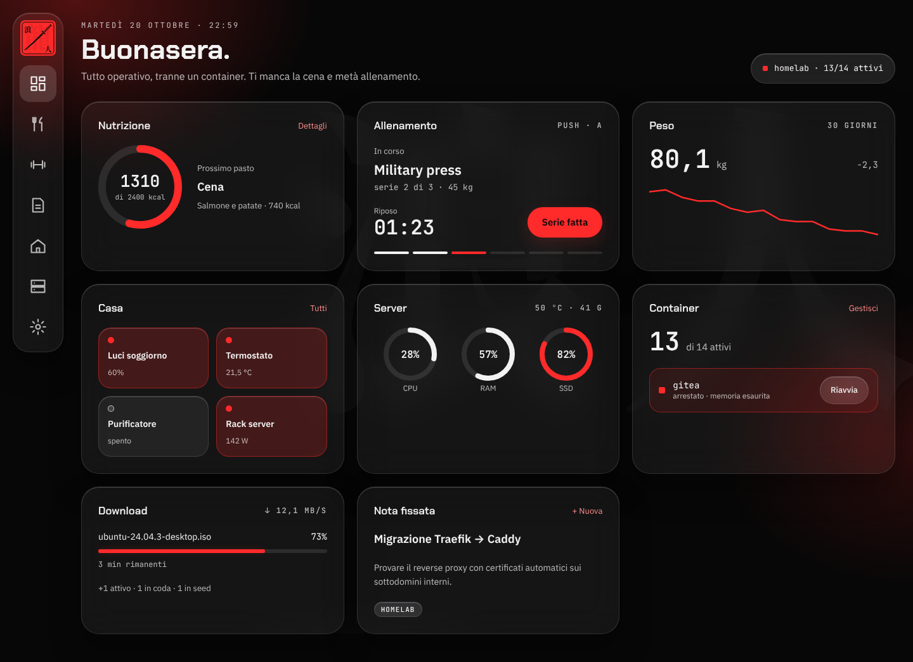

# ron1nOS

Dashboard dell'homelab [ron1n](https://github.com/1r0n51uv/ron1n): pasti,
allenamento, peso, casa, server, container, download e note in un'unica
schermata. Stile liquid glass su nero, un solo accento rosso.



## Stato

MVP desktop con dati mock. Ogni modulo verrà collegato alla sua sorgente
vera uno alla volta (vedi [`src/modules`](src/modules/README.md)). La
versione mobile arriva dopo.

## Stack

React 19, TypeScript, Vite, Tailwind CSS 4, componenti shadcn/ui (Radix),
TanStack Query, React Router.

## Sviluppo

```sh
npm install
cp .env.example .env
node e2e/fake-qbittorrent.ts   # qBittorrent finto sulla 18080, se non ne hai uno vero
docker run -d --name ron1nos-pg -p 5432:5432 \
  -e POSTGRES_USER=ron1nos -e POSTGRES_PASSWORD=ron1nos postgres:16-alpine   # Postgres per test ed e2e
npm run dev:server   # backend su http://localhost:8080
npm run dev          # http://localhost:5173, /api inoltrato al backend
npm run build        # dist/ (SPA) e dist-server/ (backend)
```

### Backend

`server/` è il backend (Hono su Node): serve la build della SPA e l'API JSON
sotto `/api/v1`, la stessa che userà l'app iOS. Il contratto è in
[`api/openapi.yaml`](api/openapi.yaml); ogni rotta nuova si aggiunge lì e
nei test. Le credenziali dei servizi (qBittorrent…) arrivano da variabili
d'ambiente e non escono mai dal backend. Nel frontend i `data.ts` chiamano
l'API con `api` di `src/lib/api.ts`, che trasforma gli errori in `ApiError`
(`code` come `qbittorrent_unreachable`). Variabili in
[`.env.example`](.env.example).

Il modulo Nutrizione ha dati propri in Postgres (`DATABASE_URL`). Le
migrazioni sono file SQL in [`server/migrations`](server/migrations),
numerati (`0002_…sql`) e applicati in ordine all'avvio; quelle già fatte
sono in `schema_migrations` e non si rifanno. Una migrazione già rilasciata
non si modifica: se ne aggiunge una nuova. Se Postgres non risponde il
backend parte lo stesso, riprova da solo e il modulo risponde
`database_unavailable` (503). I test del backend e gli e2e usano un
Postgres vero: in CI è il servizio del job, in locale quello del comando
sopra (`TEST_DATABASE_URL` ed `E2E_DATABASE_URL` per cambiarlo); ogni file
di test lavora in uno schema suo.

### Qualità del codice

| Comando                | Cosa fa                                                        |
| ---------------------- | -------------------------------------------------------------- |
| `npm run format`       | formatta tutto con Prettier (ordina anche le classi Tailwind)  |
| `npm run format:check` | controlla il formato senza modificare                          |
| `npm run lint`         | ESLint, zero warning ammessi                                   |
| `npm run typecheck`    | TypeScript su app, backend, config ed e2e                      |
| `npm test`             | test unitari e di componente con Vitest e Testing Library      |
| `npm run test:e2e`     | test end-to-end con Playwright sulla build servita dal backend |
| `npm run check`        | tutti i passi della CI, in ordine                              |

La prima volta, per gli e2e: `npx playwright install chromium`.

- Unit: accanto al file, `*.test.ts(x)`. I widget si testano sostituendo
  l'hook di `data.ts` con `vi.mock` e usando `renderWithProviders` di
  `src/test/render.tsx`.
- E2E: in `e2e/*.spec.ts`, uno o più scenari per ogni funzionalità visibile,
  cercando gli elementi per ruolo e nome accessibile. Girano sul backend
  compilato collegato a `e2e/fake-qbittorrent.ts`, il cui stato si cambia
  dai test con `POST /__fake/state` (per esempio `{ "online": false }`).
- Backend: test in `server/*.test.ts` con `// @vitest-environment node`; le
  rotte si provano con `app.request()` e un client finto.

### CI e rilascio

- `ci.yml` gira su ogni PR (job `ci`): formato, lint, typecheck, unit, build,
  e2e e build dell'immagine Docker senza push. Se gli e2e falliscono il
  report di Playwright è tra gli artifact del run.
- `release.yml` gira al push su `main` e pubblica
  `ghcr.io/1r0n51uv/ron1nos:main` e `:sha-<commit>`.

## Struttura

```
server/               backend: API /api/v1 e file statici
api/openapi.yaml      contratto dell'API
src/
  components/ui/      componenti shadcn, con lo stile ron1nOS
  components/ron1n/   componenti del design system (HankoMark, ProgressRing, NavRail…)
  modules/<modulo>/   data.ts (tipi, sorgente, hook) + Widget.tsx
  pages/              Dashboard e pagine delle sezioni
  layout/             AppShell e voci di navigazione
  index.css           token del design system e tema shadcn
```

## Deploy

L'immagine Docker (backend Node sulla porta 8080, con la SPA) viene pubblicata su
`ghcr.io/1r0n51uv/ron1nos:main` a ogni push su `main`; `sha-<commit>` resta
per il rollback. Sul server gira come
stack in `ron1n/infra`, aggiornato da Watchtower.
